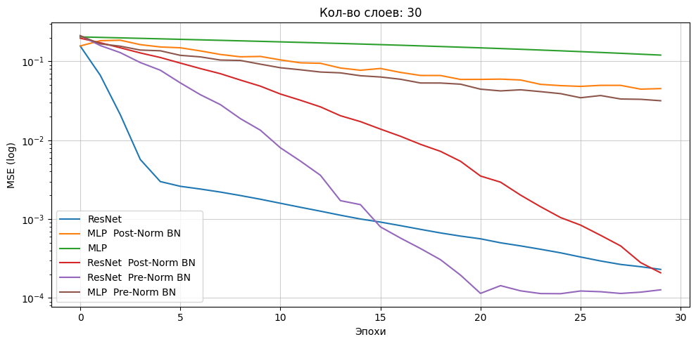
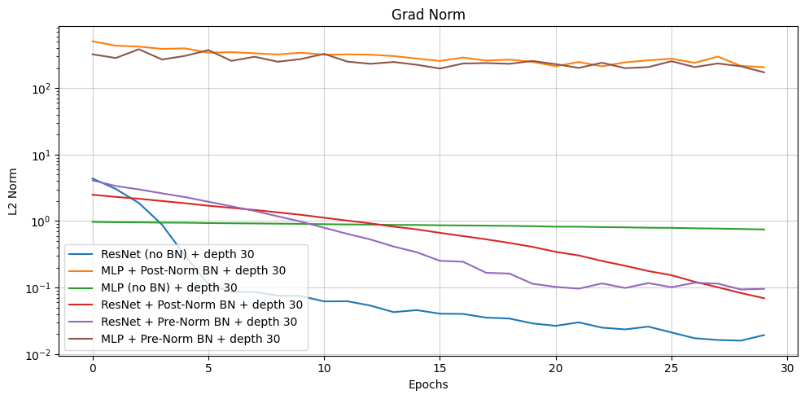

# Deep Learning Research: ResNet vs MLP

Тут будет разобрана немного тема **деградации градиента** в глубоких нейронных сетях. В рамках этого проекта было проведено сравнение архитектур **MLP** и **ResNet** на различных глубинах.

## Основная идея

Хотелось экспериментально подтвердить, почему глубокие архитектуры чаще прибегают к residual-блокам. Также хотелось посмотреть, как **Batch Normalization** влияет на процесс обучения в зависимости от места его расположения (**Pre-Norm** vs **Post-Norm**).

## Данные

Для тестов генерируется синтетический сигнал, сочетающий в себе:
* гармонические колебания;
* **детерминированный хаос**;
* гауссовский шум.

Я протестировал 6 конфигураций:
1. **MLP** (Pure)
2. **MLP + Post-Norm BN**
3. **MLP + Pre-Norm BN**
4. **ResNet** (Pure)
5. **ResNet + Post-Norm BN**
6. **ResNet + Pre-Norm BN**

Каждая модель обучалась на сетке глубин: `[2, 10, 20, 30, 40]` слоев.

## Результаты

Все предположения подтвердились. Подробнее можно посмотреть в ноутбуке `mlp_resnet_study.ipynb`. Пример:



Также визуализация норм градиентов:



## Технологии

* **Python 3.11**
* **PyTorch**
* **Matplotlib**
* **NumPy**

## Структура проекта

* `main.py` - запуск всей сетки экспериментов.
* `config.py` - гиперпараметры и конфигурации экспериментов.
* `src/model.py` - фабрика блоков и архитектуры моделей.
* `src/dataset.py` - генерация сигнала и датасет.
* `src/train.py` - пайплайн обучения и оценки.
* `mlp_resnet_study.ipynb` - графики.

## Как запустить

Я использую `uv` (нужен Python 3.11).

```bash
uv sync
uv run python main.py
```

Скрипт прогонит всю сетку экспериментов и сохранит веса моделей и `history.json` в папку `experiments/`. После этого можно открыть `mlp_resnet_study.ipynb` в окружении `.venv` и перестроить графики.
